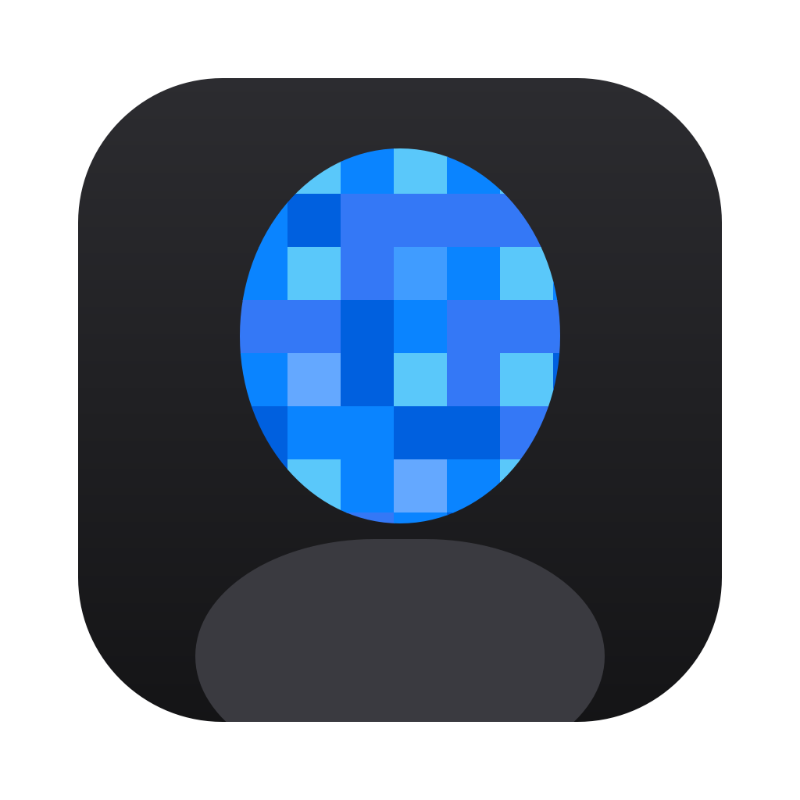

# BlurFace

완성된 영상의 얼굴을 자동으로 찾아 블러·모자이크로 가려 주는 macOS 앱 (Apple Silicon).



## 기능
- 얼굴 자동 검출·추적 (장면 전환, 같은 인물 재등장, 잠깐 놓친 얼굴 이어 가리기)
- 인물마다 다른 효과: 블러, 모자이크, 단색, 스티커, 직접 올린 이미지·GIF (강도·모양·가장자리·범위 조절)
- 파이널컷 같은 타임라인: 자르기 도구로 시간 구간마다 다른 효과, 부분 지우기
- 추적이 틀린 부분 수동 수정: 상자 추가·이동·크기 조절·지우기, 인물 합치기·나누기, 실행 취소
- 원본 화질·소리 유지한 채 내보내기 (최대 4K, 10bit HDR, 세로 영상), HEVC/H.264·화질·해상도 선택

## 필요한 것
- Apple Silicon 맥 (M1 이후), macOS 13 이상
- FFmpeg: 영상 정보 읽기·내보내기에 사용
  ```sh
  brew install ffmpeg      # Homebrew가 없으면 https://brew.sh 에서 먼저 설치
  ```

## 사용자: 앱(dmg)으로 설치
1. `BlurFace-버전.dmg`를 열고 **BlurFace**를 **응용 프로그램** 폴더로 끌어다 놓기
2. 처음 열 때 "확인되지 않은 개발자" 경고가 뜨면 (애플 개발자 서명이 없는 앱이라서)
   - **시스템 설정 → 개인정보 보호 및 보안** 맨 아래 "BlurFace" 옆 **그래도 열기** 누르기
   - 또는 터미널에서 `xattr -dr com.apple.quarantine /Applications/BlurFace.app`
3. 영상을 창에 끌어다 놓거나, Finder에서 영상 우클릭 → **다음으로 열기 → BlurFace**, 또는 Dock의 앱 아이콘에 끌어다 놓기

처음 여는 영상은 얼굴 분석을 먼저 합니다 (영상 길이와 비슷한 시간). 이후에는 바로 열립니다.

## 개발자: 소스로 실행
```sh
brew install ffmpeg uv
git clone https://github.com/limjungi/BlurFace && cd BlurFace
uv sync && scripts/download_models.sh     # 얼굴 모델 받기 (약 180MB)

uv run blurface gui [영상.mp4]            # 화면으로 열기
uv run pytest                            # 테스트
```

앱과 dmg 직접 만들기:
```sh
scripts/build_app.sh                     # → dist/BlurFace.app, dist/BlurFace-버전.dmg (약 1~2분)
```
아이콘을 바꾸려면 `packaging/make_icon.py`를 고친 뒤 `uv run python packaging/make_icon.py`.

### 명령어로 쓰기 (CLI)
```sh
uv run blurface run 영상.mp4                    # 분석 + 영상_mosaic.mp4 생성
uv run blurface persons 영상.mp4                # 인물 번호 확인 (~/Movies/BlurFace/영상.blurface/persons.jpg)
uv run blurface render 영상.mp4 --person 1=sticker:smile --person 4=none
uv run blurface render 영상.mp4 --person-at 1@12-20=sticker:heart   # 인물 1만 12~20초 하트
uv run blurface render 영상.mp4 --codec h264 --quality small --resolution 720p   # 가볍게 내보내기
```
효과:`mosaic[:블록수]` `blur[:강도]` `solid[:#색]` `sticker[:smile|heart]` `image:파일.png|gif` `none` (GIF는 움직임)
옵션(쉼표로 이어 붙임): `shape=rect|rounded|ellipse` 모양, `feather=0~50` 가장자리 부드럽게, `scale=50~300` 가리는 범위(%)
예: `--person 2=blur:40,shape=ellipse,feather=20`

## 화면 사용법 (파이널컷과 비슷한 배치)
- 왼쪽 사이드바 = 프로젝트 목록 (표지·길이·인물 수·최근 수정). 눌러서 열기, 우클릭: Finder에서 보기·원본 다시 연결·삭제. 도구 막대 맨 왼쪽 버튼이나 `⌥⌘S`로 열고 닫기
- `.blurface` 프로젝트는 Finder에서 파일 하나로 보이고 더블클릭하면 BlurFace로 열림. ⌘O·창에 끌어다 놓기로도 열 수 있음
- 미리보기에서 소리도 재생 (0.5×·2×에서도 목소리 높이 유지). 🔊 버튼·음량 막대, `M` 음소거
- 효과는 한 줄 아이콘 (마우스를 올리면 이름). 내 이미지 썸네일에 마우스를 올리면 × 로 보관함에서 지우기
- 내 이미지는 여러 개를 한 번에 올릴 수 있음 (＋에서 여러 개 선택, 또는 이미지 파일들을 창에 끌어다 놓기)
- 효과를 따로 정하지 않은 사람은 맨 위 "나머지 N명" 한 줄로 묶임 (▸로 펼치기). 이 줄의 효과는 나머지에게만 적용
- 따로 효과를 정한 사람은 자기 줄이 생김. 막대 색 = 그 사람에게 걸린 효과 (기본: 타원 블러)
- 미리보기에서 얼굴을 클릭하면 그 사람이 선택되어 바로 효과 변경
- 효과 칩(`블러 ▾`)이나 오른쪽 설정에서 효과 변경. 내 이미지는 한 번 올리면 보관함에 저장
- 타임라인 위 [선택 A] [자르기 B] 도구. 자르기 도구로 막대를 클릭하면 그 자리에서 잘림 (⌘B는 재생 위치에서 자르기)
- 자른 부분을 눌러 고른 뒤 효과를 바꾸거나 ⌫로 지우기. 자른 곳·막대 끝은 좌우로 끌어 길이 조절
- 핀치·⌘+스크롤·[−][+][전체 보기] 버튼으로 타임라인 확대/축소, 이름 더블클릭으로 이름 바꾸기, 우클릭 메뉴(합치기·삭제)
- 맨 위 메뉴(파일·편집·도구·재생·보기)에 모든 기능과 단축키. 분석·내보내기가 끝나면 다른 창을 보고 있을 때 알림
- 재생 막대로 바로 이동, 0.5×/1×/2× 재생, `F` 전체 화면(마우스를 움직이면 재생 막대 표시), `E` 얼굴 상자 고치기, `N` 확인할 곳, `⌘Z` 실행 취소

놓친 얼굴 직접 가리기: 그 사람 선택 → `E`(얼굴 상자 고치기) → 놓친 시작 프레임에서 얼굴 위를 끌어 상자 그리기 → 끝 프레임에서 한 번 더 그리기 → 사이는 자동으로 이어짐

## 지원 형식
| 구분 | 형식 |
|---|---|
| 열기 | mp4, mov, m4v, mkv, avi, webm (끌어다 놓으면 FFmpeg가 읽는 형식 대부분). H.264·HEVC·ProRes·VP9·AV1, 4K·10bit HDR·세로 영상 |
| 내보내기 | mp4 (HEVC 또는 H.264), 원본 소리 그대로 |
| 내 이미지 | png, jpg, webp, gif (움직이는 GIF는 영상에서도 움직임). 배경이 투명한 PNG 추천 |

## 저장 위치
| 무엇 | 어디 |
|---|---|
| 프로젝트 (분석 결과, 효과, 고친 상자, 백업) | `~/Movies/BlurFace/영상이름.blurface/` (사용자마다 자기 '동영상' 폴더에 자동 생성). **파일 → 프로젝트 저장 위치**에서 변경 가능 |
| 원본 영상 | 복사하지 않고 위치만 기억. 옮기면 사이드바에서 눌러 다시 연결 |
| 내 이미지 보관함 | `~/Library/Application Support/BlurFace/stickers/` |
| 결과 영상 | 기본값: 영상 옆 `영상이름_mosaic.mp4` |

## 라이선스 참고
- 얼굴 검출·인식 모델(InsightFace buffalo_l: SCRFD, ArcFace)은 **비상업적 용도로만** 사용할 수 있습니다. 모델은 저장소에 포함하지 않고 `scripts/download_models.sh`로 공식 위치에서 받습니다. 수익 창출·상업적 이용 시 InsightFace에 별도 라이선스를 문의하세요.
- FFmpeg는 사용자가 설치한 것을 불러 씁니다 (앱에 포함하지 않음).

## 스택
Python 3.12 · PyAV/FFmpeg(VideoToolbox) · ONNX Runtime(CoreML) · SCRFD · ArcFace · PySide6 · PyInstaller

계획: [docs/PLAN.md](docs/PLAN.md)
